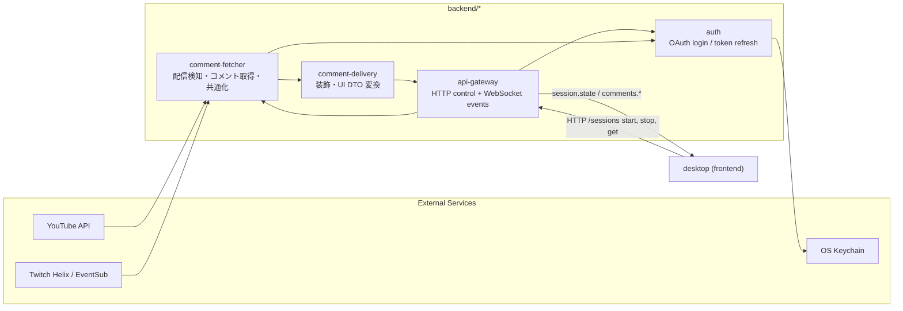
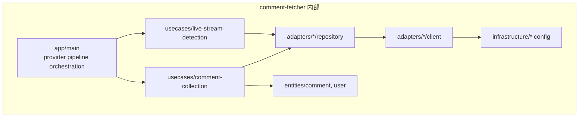

# backend

YouTube / Twitch の認証、配信検知、コメント取得、UI 向け配信を担うバックエンド群です。

現在の desktop 向け入口は `backend/api-gateway` に集約しています。desktop は Gateway の HTTP / WebSocket だけを見て、`comment-fetcher` / `comment-delivery` / `auth` は Gateway からライブラリとして利用されます。

## バックエンド全体の関係図





- `api-gateway`: desktop 向けの HTTP control plane と WebSocket event plane を 1 プロセスで提供。
- `auth`: 各 provider の OAuth を担当し、トークンを安全に保存（Keychain）。
- `comment-fetcher`: 外部 API と直接やり取りして配信検知・コメント取得を行い、共通ドメインへ正規化。
- `comment-delivery`: `comment-fetcher` のコメントを UI DTO に変換し、必要なら装飾するライブラリ。WebSocket サーバは持たない。
- `desktop`: `api-gateway` の HTTP / WebSocket を利用して配信開始・停止とコメント・セッション状態受信を行うクライアント。

## 実行

desktop と Gateway をまとめて起動する場合は、リポジトリルートで実行します。

```bash
pnpm dev
```

Gateway のみ起動する場合:

```bash
pnpm dev:api-gateway
```

`comment-fetcher` のパイプライン単体を開発・確認したい場合は、従来通り `pnpm dev:comment-fetcher` も利用できます。

## 必要な環境変数

最低限、利用する provider 側の設定が必要です。

```env
# YouTube OAuth (backend/auth)
YOUTUBE_OAUTH_CLIENT_ID=
YOUTUBE_OAUTH_CLIENT_SECRET=
# YOUTUBE_OAUTH_AUTHORIZATION_ENDPOINT=https://accounts.google.com/o/oauth2/v2/auth
# YOUTUBE_OAUTH_TOKEN_ENDPOINT=https://oauth2.googleapis.com/token
# YOUTUBE_OAUTH_SCOPES=https://www.googleapis.com/auth/youtube.readonly

# Twitch
TWITCH_CLIENT_ID=
TWITCH_TARGET_CHANNEL_ID=   # login 名（例: twitchdev）

# Optional
# TWITCH_HELIX_API_BASE_URL=https://api.twitch.tv/helix
# TWITCH_EVENTSUB_WS_URL=wss://eventsub.wss.twitch.tv/ws

# API Gateway
API_GATEWAY_HTTP_HOST=127.0.0.1
API_GATEWAY_HTTP_PORT=17332
API_GATEWAY_WS_HOST=127.0.0.1
API_GATEWAY_WS_PORT=17331

# Live stream detection
# LIVE_STREAM_POLLING_INTERVAL_MS=5000
# LIVE_STREAM_MAX_ATTEMPTS=5
```

YouTube / Twitch ともにアクセストークンを直接設定せず、`@comment-dock/auth` を通して OAuth ログインします。
初回は次を実行してください。

```bash
pnpm --filter @comment-dock/auth login youtube
pnpm --filter @comment-dock/auth login twitch
```

## ディレクトリ構成

`src` 配下は Clean Architecture / FSD を意識して分割しています。

- `app/`
  - 実行オーケストレーション（pipeline 構築、provider 並列実行）
- `usecases/`
  - アプリケーションルール
  - `live-stream-detection/`: 配信中検出
  - `comment-collection/`: コメント収集（YouTube / Twitch）
- `adapters/`
  - 外部仕様との変換・接続
  - `youtube/`, `twitch/`: provider 固有実装
  - `presenters/`: 出力用アダプター
- `entities/`
  - provider 非依存ドメイン（`Comment`, `User`）
- `infrastructure/`
  - 低レイヤ設定・抽象
  - `shared/`: 共通契約（`HttpClient`, `AccessTokenProvider` など）
  - `youtube/`, `twitch/`: provider 設定値

## アーキテクチャ方針

- **依存方向は内側へ**
  - `usecases` は `repository interface` に依存
  - `adapters` がその interface を実装
- **provider 詳細は adapter に閉じる**
  - YouTube Data API / Twitch Helix + EventSub DTO は `adapters/*/dto` に限定
- **共通ドメインで統一**
  - 取得結果は `entities/comment` に正規化
- **DI 前提**
  - `tsyringe` で実装差し替えを容易化
  - 例: `HttpClient` はトークン定義 + `index.ts` で `fetch` を登録

## 実装ポリシー

- mapper で「外部イベント -> 共通 Comment」へ変換し、未対応イベントは明示的に除外
- repository は「クライアントのストリーム/レスポンスをユースケース契約に合わせる薄い層」
- usecase は再接続制御やポーリングなどの業務フローを担当

## Twitch 実装の要点

- リアルタイム取得: EventSub WebSocket
- サブスク作成: Helix `eventsub/subscriptions`
- 購読イベント:
  - `channel.chat.message`
  - `channel.chat.notification`
- `Client-Id` と `Bearer token` を常に併用
- `session_keepalive` など通知系メッセージは受信しても処理対象外として無視

## テスト / 型チェック

```bash
pnpm --filter @comment-dock/api-gateway test
pnpm --filter @comment-dock/api-gateway check-types
pnpm --filter @comment-dock/comment-fetcher test
pnpm --filter @comment-dock/comment-fetcher check-types
pnpm --filter @comment-dock/comment-delivery test
pnpm --filter @comment-dock/comment-delivery check-types
```

## 今後の主タスク

- provider ごとの障害分離（片系エラー時も他系継続）
- コメントポリシー拡張（例: Twitch 絵文字のみ投稿の扱い）
